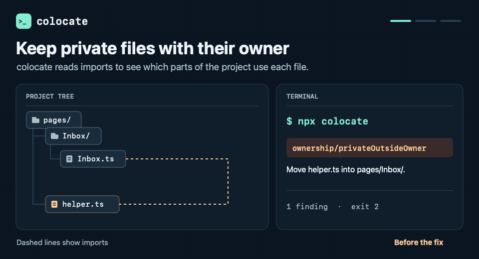

# colocate

colocate checks where files live in your project by looking at what imports them.

If only one part of your project uses a file, keep it with that code. If several parts use it, put it in the nearest folder that contains them all. colocate tells you where to move a file and points out unnecessary folders that hold just one source file.

You can run colocate from your terminal or add it to your project's automated checks.



## Install

```bash
npm i -D @gosukiwi/colocate
```

Requires Node 20+.

## Usage

```bash
npx colocate              # check the project in the current directory
npx colocate src          # override the configured root
npx colocate --format json
npx colocate --config path/to/colocate.config.json
```

`ownership` and `entry` are the two rules you can run. Each problem a rule reports is called a Finding. colocate prints each Finding and exits with code `2` when there are any.

## Configuration

colocate looks for `colocate.config.json` in the directory where you run it. Use `--config` to choose another file. Every option is optional. colocate rejects unknown option names.

```json
{
  "root": "src",
  "layers": ["src/ui"],
  "ignore": ["**/*.generated.ts"],
  "rules": ["ownership", "entry"]
}
```

- See [Options](#options) for `root`, `ignore`, and `layers`.
- `rules` chooses which rules to run. The default runs both `ownership` and `entry`.

## Examples

**Only `MyPage` uses `helper.ts`**

```
# BAD
src/pages/helper.ts
src/pages/MyPage/MyPage.ts

# GOOD
src/pages/MyPage/MyPage.ts
src/pages/MyPage/helper.ts
```

**Both `A` and `B` use `fmt.ts`**

```
# BAD: inside A's folder
src/pages/A/A.ts
src/pages/A/fmt.ts
src/pages/B/B.ts

# BAD: a level above the folder they share
src/fmt.ts
src/pages/A/A.ts
src/pages/B/B.ts

# GOOD: in pages/, the nearest folder that contains both
src/pages/fmt.ts
src/pages/A/A.ts
src/pages/B/B.ts
```

**`Foo` has its own folder with just one file**

```
# BAD
src/Foo/Foo.ts

# GOOD: move Foo.ts up a level
src/Foo.ts

# GOOD: keep Foo.ts with its stylesheet
src/Foo/Foo.ts
src/Foo/Foo.module.css
```

**`App` imports `Home`, and `Home` stays in `pages`**

```
# GOOD
src/main.ts              (nothing imports this file)
src/App.ts               (only main.ts imports this file)
src/pages/Home/Home.ts   (App.ts imports this file)
```

**`layers: ["src/ui"]` lets `Button` stay in `src/ui`**

```
# GOOD even if only Home imports Button
src/ui/Button/Button.ts
src/pages/Home/Home.ts
```

## How `ownership` works

colocate reads the imports under `root` to find out which parts of the project use each file.

**Owners.** A folder counts as an owner if it has a file named after it, such as `pages/MyPage/MyPage.ts`, or if outside code imports it through its `index` file. When an `index` only groups independent helpers, the helpers each count as their own owner. A file outside any owner folder also owns itself.

**Private files.** If one owner imports a file, the file belongs in that owner's folder.

**Shared files.** If two or more owners import a file, it belongs in the nearest folder that contains all of them.

A folder's entry file belongs in its own folder. If the folder needs to move, colocate reports that when it checks placement higher up.

**The app shell.** Files that start the app often import pieces that belong elsewhere. When `main.ts` imports `App.ts` and `App.ts` imports `pages/Home/Home.ts`, colocate lets `Home` stay in `pages` without any configuration. The exception applies when the importer is a file that nothing imports, or when such a file imports it directly. If a different owner also imports the same file, colocate counts it as shared.

If your app starts through more files, such as `main`, `router`, and `App`, use `layers` for the folders that should keep their place. The same applies if the app shell uses standalone files at the top level.

## What it reports

The table lists the Findings from `ownership`. See [The entry rule](#the-entry-rule) for `reachesPastEntry` and `namedDoorReexport`.

| Finding               | What it means                                                                                       | Usual fix                                                                                                             |
| --------------------- | --------------------------------------------------------------------------------------------------- | --------------------------------------------------------------------------------------------------------------------- |
| `privateOutsideOwner` | One owner imports the file, which lives outside that owner's folder.                                | Move it into the owner's folder. If the owner is a standalone file, put both files in a folder named after the owner. |
| `sharedTooHigh`       | The file sits above the nearest folder that contains all its owners.                                | Move it down to that folder.                                                                                          |
| `sharedInsideOwner`   | Several owners import the file, and it lives inside one owner's folder.                             | Move it to the nearest folder that contains all its owners.                                                           |
| `singletonFolder`     | A folder has one source file named `index` or named after the folder, with no stylesheet beside it. | Move the file up a level or put related files beside it.                                                              |

`singletonFolder` looks in the same folder for `.css`, `.scss`, `.sass`, `.less`, and `.styl` files.

An `index` that re-exports at least two files in the same folder is allowed.

## Options

Both checks use `root` and `ignore`. Only `ownership` uses `layers`.

### `root`

The folder to check. It also sets the outer limit for where `ownership` can place files. The default is `"."`, the current directory. Set it to `"src"` to check that folder.

For a relative `root`, colocate starts in the directory where you ran it and looks in parent directories if needed. The search stops at the nearest `package.json` or `.git`. Reports cover files under `root`. A `root` argument on the command line overrides the config file.

### `layers`

Use `layers` for folders whose direct children should stay in place, even if only one part of the project uses them. With `layers: ["src/ui"]`, `src/ui/Button` stays in `src/ui` even if only one page uses it.

colocate matches paths relative to `root` and to the directory where you ran it. With `root: "src"`, both `["ui"]` and `["src/ui"]` work.

This applies to files directly in the layer and the entry file of each child folder, such as `Button/Button.ts` or `Button/index.ts`. colocate still checks the placement of files such as `ui/Button/internals/state.ts`.

Use these layers if a longer app startup sequence should leave top-level modules and pages in place.

```json
{ "layers": ["src", "src/pages"] }
```

### `ignore`

List the paths or glob patterns to skip, relative to `root`. colocate skips those files and their imports. A pattern that matches a folder excludes everything inside it. List exclusions directly because colocate does not support `!` patterns.

## The entry rule

The `entry` check controls which files other parts of the project can import. A folder is a module if it has an entry file named after the folder or named `index`. Code outside the module must import from an entry file.

```
src/pages/Inbox/Inbox.ts
src/pages/Inbox/state.ts

// BAD: imports state.ts directly
import { loadThread } from "../pages/Inbox/state.ts";

// GOOD: imports through Inbox.ts
import { loadThread } from "../pages/Inbox/Inbox.ts";
```

**Nested modules.** Outside code can also import a nested module's entry file, such as `pages/Inbox/FilterPanel/FilterPanel.ts`.

**Folders without an entry file.** Code can import individual files from folders such as `lib/` or `tabs/` when they have no entry file and sit outside any module. Adding an entry file makes the folder a module and restricts outside imports.

**App startup files.** The same import restrictions apply to files nothing imports, such as `main.ts`.

**Re-exports.** Use `index.ts` when a module needs to pass through exports from other files. If an entry file named after its folder, such as `Foo/Foo.ts`, passes through a value from another source file that colocate checks, colocate reports `namedDoorReexport`. Move the re-export to `index.ts` or remove it. Type-only re-exports are allowed. colocate reports an outside import directly into a module's internal file as `reachesPastEntry`.

`entry` uses `root` and `ignore`. Keep entry files out of `ignore` so colocate can recognize the folders as modules. colocate reports the import for you to fix. When you switch an import to an entry file, make sure that file exports the name you need.

## Output format

In text mode, colocate writes one Finding per line to standard error (`stderr`).

```
path:line:col  rule/kind  message
src/pages/helper.ts  ownership/privateOutsideOwner  File is imported by a single owner but sits outside that owner's folder; move it into 'src/pages/MyPage/'.
src/app.ts:3:21  entry/reachesPastEntry  'src/pages/Inbox/state.ts' is inside module 'src/pages/Inbox'; import it through 'src/pages/Inbox/Inbox.ts', or move it out of 'src/pages/Inbox' if it is not part of it.
```

Paths are relative to the directory where you ran colocate. Import Findings include a line and column. File placement Findings give just the path.

With `--format json`, colocate writes one JSON object to standard output (`stdout`).

```json
{
  "findings": [
    {
      "rule": "entry",
      "kind": "reachesPastEntry",
      "file": "src/app.ts",
      "line": 3,
      "column": 21,
      "message": "...",
      "data": { "target": "src/pages/Inbox/state.ts" }
    }
  ],
  "staleBaseline": 2
}
```

For `ownership` Findings, `data.destination` gives the folder to move into. The path is relative to the directory where you ran colocate and ends in `/`.

If a `privateOutsideOwner` Finding names a standalone file as the owner, `data.owner` gives that file's path. `data.moving` gives the other file's path, or its folder's path if the file is the folder's entry. Move both paths into `data.destination`, creating the folder if needed. If the other path is already at or inside its destination, `data.moving` is absent and only `data.owner` needs to move.

Only import Findings have `line` and `column`. `staleBaseline` counts Baseline entries that no longer match a Finding and appears only when the count is above zero. If colocate can't run, for example because the config is invalid or the Baseline is unreadable, it outputs `{ "error": "<message>" }`.

## Exit codes

| Code | Meaning                                               |
| ---- | ----------------------------------------------------- |
| `0`  | The checks passed.                                    |
| `2`  | colocate found a problem or could not run the checks. |

colocate uses exit code `2` for both Findings and errors so Claude Code hooks show the message to the agent. Claude Code treats other nonzero exit codes as nonblocking.

## Baseline

A Baseline is a list of Findings you've accepted. Keep it in `colocate.baseline.json` to start using colocate on an existing project and see new Findings as they come up.

- `colocate --baseline-add-all` records every current Finding. Run it yourself when adopting colocate. Agents must not use it.
- `colocate --update-baseline` removes entries for Findings that no longer occur. It adds entries only if the Baseline file is missing, in which case it creates the file from the current Findings.
- Until you run `--update-baseline`, colocate reports those old entries as stale. In JSON output, the count is `staleBaseline`.

## Hooks and CI

**Git pre-push hook.** Save this as `.git/hooks/pre-push` and make it executable.

```sh
#!/bin/sh
npx colocate
```

**Claude Code `Stop` hook.** Add this to `.claude/settings.json` to show Findings to the agent before it finishes.

```json
{
  "hooks": {
    "Stop": [{ "hooks": [{ "type": "command", "command": "npx colocate" }] }]
  }
}
```

**GitHub Actions.** Run colocate after installing the project's dependencies.

```yaml
- run: npx colocate
```

## Notes

- colocate uses TypeScript to find imported files. It follows `paths` and `baseUrl` from the nearest `tsconfig.json`, supports imports without extensions, and can resolve `./x.js` to `x.ts`.
- colocate skips tests, `node_modules`, `dist`, coverage output, version control folders, and `.d.ts` files.
- colocate skips code it can reach only through a chain of imports that loops back on itself. Break the loop to check that code.
- Use the capitalization from disk in config paths, even on a case-insensitive filesystem. For example, use `root: "src"` for a folder named `src`.
